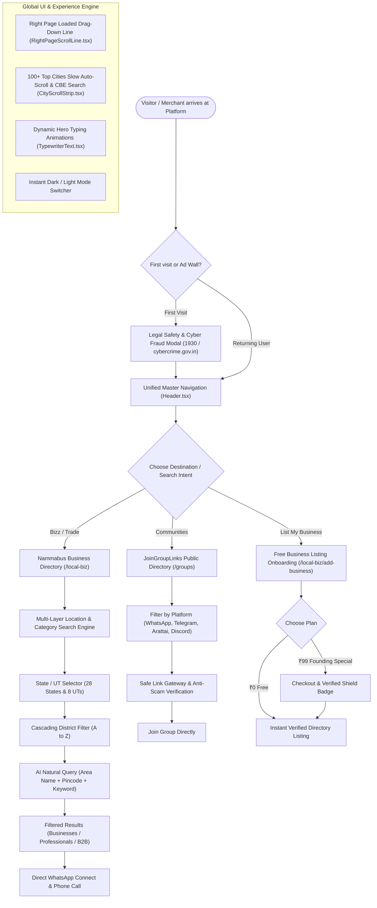
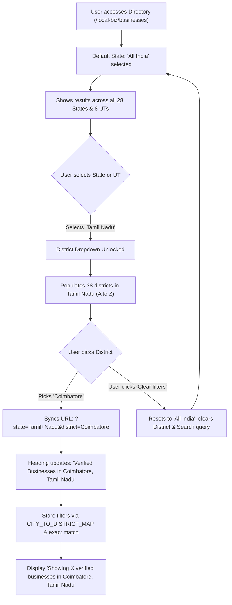
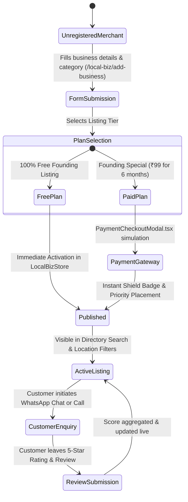

# Platform Features & System Architecture Guide

This document provides a complete architectural map and visual flowcharts for the dual-engine platform: **Nammabus** (India's verified business & professional directory) and **JoinGroupLinks.in** (public community & group directory).

---

## 1. High-Level System Architecture & User Flow

---

## 2. Directory Search & Location Filtering Flow

The location filtering engine is built around official territorial boundaries in [`src/lib/india.ts`](file:///c:/Users/NTC/AntiGravity/GroupSharing_Project/src/lib/india.ts) and cascading selects in [`src/components/common/LocationSearchFilter.tsx`](file:///c:/Users/NTC/AntiGravity/GroupSharing_Project/src/components/common/LocationSearchFilter.tsx).

---

## 3. Core Feature Modules Breakdown

### A. Dual Engine Header & Brand Identity
- **File**: [`src/components/Header.tsx`](file:///c:/Users/NTC/AntiGravity/GroupSharing_Project/src/components/Header.tsx)
- **Features**:
  - **Single-Row Tier 1**: Logo with `N` mark, `Nammabus & GROUPS`, primary links (`Home`, `Nammabus`, `JoinGroupLinks`), Theme Switcher, and User Profile.
  - **Contextual Tier 2**: Location selector pill searching across 28 States, 8 UTs, and districts; quick links to B2B Wholesale, Professionals, Categories, and the Free Listing CTA.

### B. Business & Service Directory
- **Files**: [`src/app/local-biz/businesses/page.tsx`](file:///c:/Users/NTC/AntiGravity/GroupSharing_Project/src/app/local-biz/businesses/page.tsx), [`src/lib/local-biz/store.ts`](file:///c:/Users/NTC/AntiGravity/GroupSharing_Project/src/lib/local-biz/store.ts)
- **Features**:
  - Location Search Filter with state `<optgroup>`s and dependent district dropdown.
  - Multi-token AI Query Search (e.g. `Doctor Anna Nagar 600040`).
  - View modes (Grid / List view switcher) and sorting (Featured, Rating, Name).
  - One-click direct WhatsApp chat opening pre-formatted quote requests.

### C. Verified Practice & Professional Directory
- **Files**: [`src/app/local-biz/professionals/page.tsx`](file:///c:/Users/NTC/AntiGravity/GroupSharing_Project/src/app/local-biz/professionals/page.tsx)
- **Features**:
  - Direct listings for certified Doctors, Advocates/Lawyers, Chartered Accountants, Architects, and Engineers.
  - Cascading State/District search + Profession filter.
  - Clear credential badges (Bar Council, ICAI, MCI) and consultation fees transparency.

### D. B2B Wholesale & Industrial Hub
- **Files**: [`src/app/b2b/page.tsx`](file:///c:/Users/NTC/AntiGravity/GroupSharing_Project/src/app/b2b/page.tsx)
- **Features**:
  - Industrial supplier discovery (machinery, textiles, agro commodities, medical gear).
  - Fast RFQ (Request for Quotation) generator logging bulk inquiries to the store.
  - Cascading State and District filters.

### E. JoinGroupLinks Community Directory
- **Files**: [`src/app/groups/page.tsx`](file:///c:/Users/NTC/AntiGravity/GroupSharing_Project/src/app/groups/page.tsx), [`src/app/groups-2026/page.tsx`](file:///c:/Users/NTC/AntiGravity/GroupSharing_Project/src/app/groups-2026/page.tsx)
- **Features**:
  - 30+ platform coverage with focus on Arattai (by Zoho), WhatsApp, Telegram, and Discord.
  - Geo-targeted group browsing by state, city, and category (Jobs, Study, Crypto, Medical).
  - 2026 SEO cornerstone guide featuring 7,000+ active links and FAQ schema.

### F. Navigation & Interactive Visual Enhancements
- **Top 100 Indian Cities Auto-Scroll**: [`src/components/common/CityScrollStrip.tsx`](file:///c:/Users/NTC/AntiGravity/GroupSharing_Project/src/components/common/CityScrollStrip.tsx)
  - 100+ cities with authentic landmark photos (Adiyogi for Coimbatore, Hawa Mahal for Jaipur, etc.).
  - Smooth continuous auto-scroll (~25px/sec) that pauses on hover.
  - Quick alias search supporting codes like `CBE`, `BLR`, `HYD`, `DEL`, `BOM`.
- **Right Page Loaded Drag-Down Line**: [`src/components/common/RightPageScrollLine.tsx`](file:///c:/Users/NTC/AntiGravity/GroupSharing_Project/src/components/common/RightPageScrollLine.tsx)
  - Floating vertical scrollbar rail on the right edge of the screen.
  - Draggable handle thumb enabling users to drag down or up to scroll smoothly.
  - Top and bottom chevrons for instant 1-click jump to top ($0\%$) or bottom ($100\%$).
- **Hero Dynamic Typewriters**: [`src/components/common/TypewriterText.tsx`](file:///c:/Users/NTC/AntiGravity/GroupSharing_Project/src/components/common/TypewriterText.tsx)
  - Smooth typewriter animations across all 10 page heroes.

### G. Legal, Compliance & Cyber Safety
- **Files**: [`src/components/LegalSafetyDisclaimerModal.tsx`](file:///c:/Users/NTC/AntiGravity/GroupSharing_Project/src/components/LegalSafetyDisclaimerModal.tsx), [`src/components/Footer.tsx`](file:///c:/Users/NTC/AntiGravity/GroupSharing_Project/src/components/Footer.tsx)
- **Features**:
  - First-visit legal disclaimer covering Third-Party Listings, Group Disclaimers, and Banking Fraud Awareness.
  - Indian Cybercrime Helpline **1930** and direct links to **cybercrime.gov.in**.
  - Dual footers with `"Made in India, Made with ❤️ for India"` and AI data accuracy notices.

---

## 4. Merchant Lifecycle & Transaction State Flow

